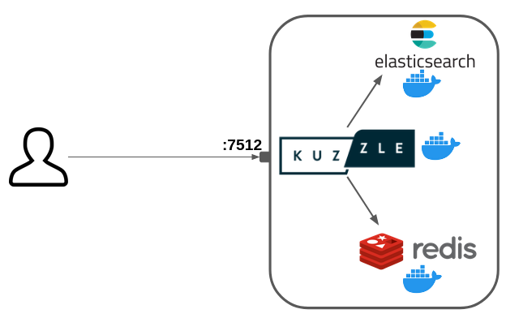

# Deploy your Application

Kuzzle is just a Node.js application that also needs [Elasticsearch](https://www.elastic.co/what-is/elasticsearch) and [Redis](https://redis.io/topics/introduction) to run.  

Kuzzle uses native (C++) dependencies. They ship prebuilt for Linux x64 and arm64 (glibc 2.31 or later, e.g. Debian bullseye and later) and for macOS, so `npm install` needs no compiler there. On Alpine Linux (musl) or other architectures, they are compiled at install time, which needs `python3`, `make` and a C++ compiler such as `g++`.

Kuzzle is tested with Elasticsearch 7.17 and 8.17, and with Redis 8 (see [Supported versions](/core/2/guides/getting-started/run-kuzzle#supported-versions)).

At Kuzzle we like to use Docker and Docker Compose to quickly deploy applications.  
In this guide we will see how to deploy a Kuzzle application on a remote server.

**Prerequisites:**
  - A SSH access to a remote server running on Linux
  - [Docker](https://docs.docker.com/engine/install/) and [Docker Compose](https://docs.docker.com/compose/install/) installed on this server
  - A Kuzzle application

::: info
In this guide we will perform a basic deployment of a Kuzzle application.  
For production deployments, we strongly recommend to deploy your application in [cluster mode](/core/2/guides/advanced/cluster-scalability) to take advantage of high availability and scalability.  
Our team can bring its expertise and support for such deployments: [get a quote](https://info.kuzzle.io/contact-us)
:::

## Target architecture

We will deploy the following services in Docker containers:
 - Node.js (Kuzzle)
 - Elasticsearch
 - Redis

We will use Docker Compose as a basic container orchestrator.

Only Kuzzle will be exposed to the internet on the port 7512.



::: warning
This deployment does not use any SSL encryption (HTTPS).  
A production deployment must include a reverse proxy to securize the connection with SSL.
:::

::: warning
**Authentication security in production**

You must set the `kuzzle_security__authToken__secret` environment variable before deploying Kuzzle to production. This secret is used to sign and verify JSON Web Tokens (JWTs) for user authentication.

Without it, Kuzzle generates a random signing seed and stores it in its internal index in Elasticsearch: anyone who can read that index can forge authentication tokens. Setting the secret yourself keeps it out of the database and gives you direct control over it.

Changing the secret immediately invalidates all existing authentication tokens: users have to log in again.

For other configuration options, see the [sample configuration file](https://github.com/kuzzleio/kuzzle/blob/master/.kuzzlerc.sample.jsonc).
:::

## Prepare our Docker Compose deployment

We are going to write a `docker-compose.yml` file that describes our services.  

First, create a `deployment/` directory: `mkdir deployment/`

Then create the `deployment/docker-compose.yml` file and paste the following content:

```yaml
---
services:
  kuzzle:
    build:
      context: ../
      dockerfile: deployment/kuzzle.dockerfile
    command: node /var/app/app.js
    restart: always
    container_name: kuzzle
    ports:
      - "7512:7512"
      - "1883:1883"
    depends_on:
      - redis
      - elasticsearch
    environment:
      - kuzzle_services__storageEngine__client__node=http://elasticsearch:9200
      - kuzzle_services__internalCache__node__host=redis
      - kuzzle_services__memoryStorage__node__host=redis
      - kuzzle_security__authToken__secret=<a long random secret>
      - NODE_ENV=production

  redis:
    image: redis:8
    command: redis-server --appendonly yes
    restart: always
    volumes:
      - redis-data:/data

  elasticsearch:
    image: kuzzleio/elasticsearch:7
    restart: always
    ulimits:
      nofile: 65536
    volumes:
      - es-data:/usr/share/elasticsearch/data

volumes:
  es-data:
    driver: local
  redis-data:
    driver: local
```

This configuration allows to run a Kuzzle application with Node.js alongside Elasticsearch and Redis.

We are going to use a [multi-stage Dockerfile](https://docs.docker.com/develop/develop-images/multistage-build/) to build the application and then use the [node:24](https://hub.docker.com/_/node) image (Kuzzle needs Node.js 22.12 or later) to run the application.

Create the `deployment/kuzzle.dockerfile` file with the following content:

```dockerfile
# builder image
FROM node:24 AS builder

# node:24 is a Debian (glibc) image: Kuzzle's native dependencies are
# prebuilt for it, so there is nothing to compile

ADD . /var/app

WORKDIR /var/app

RUN  npm ci && npm run build && npm prune --omit=dev

# run image
FROM node:24

COPY --from=builder /var/app /var/app

```

## Deploy on your remote server

Now we are going to use `scp` (SSH copy) to copy our application on the remote server.  

```bash
$ scp -r ../playground <user>@<server-ip>:.
```

Then simply connect to your server and run your application with Docker Compose:

```bash
$ ssh <user>@<server-ip>

[...]

$ docker compose -f deployment/docker-compose.yml up -d
```

Your Kuzzle application is now up and running on port 7512!

<GuidesLinks 
  :prev="{ text: 'Customize API Behavior', url: '/guides/getting-started/customize-api-behavior/' }" 
/>
